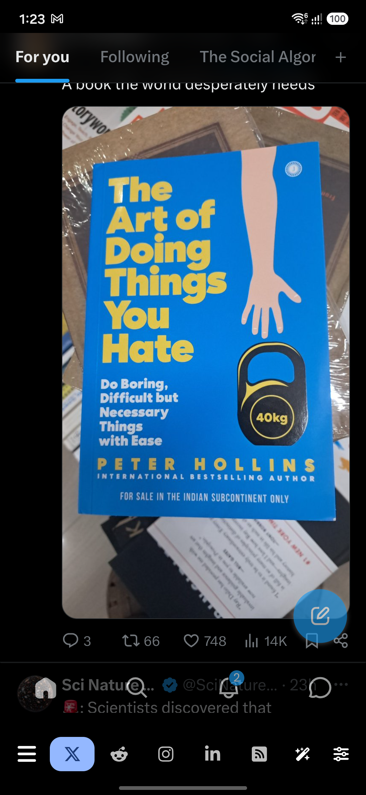
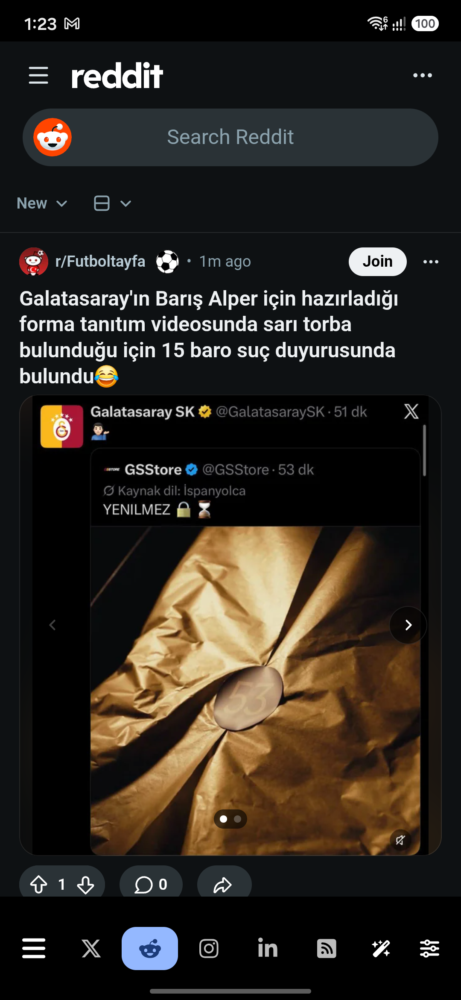
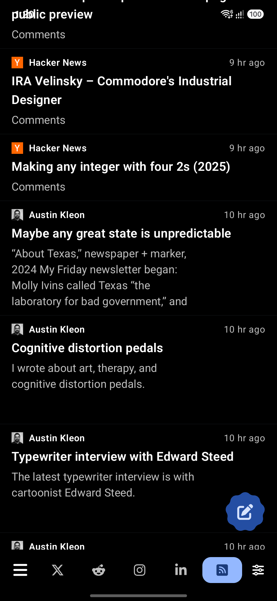
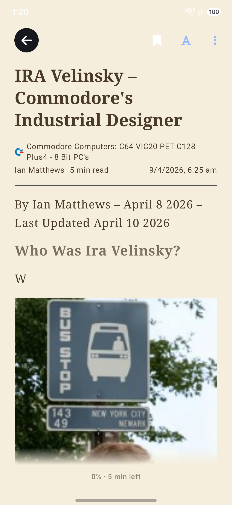
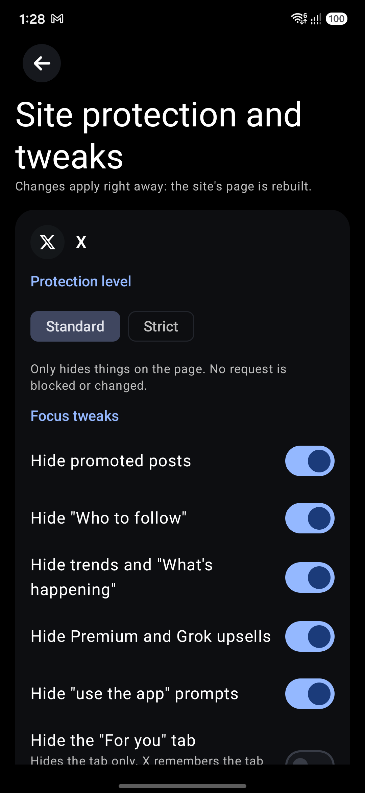
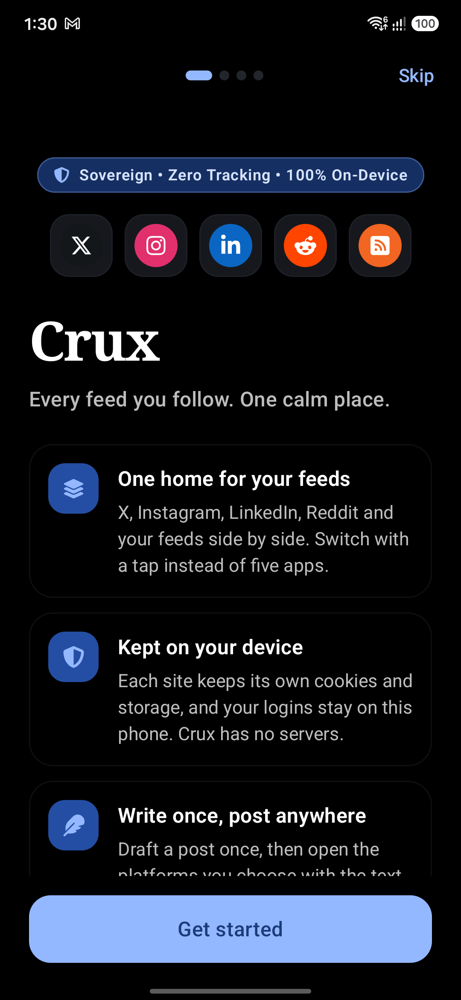

<p align="center">
  
</p>

<h1 align="center">Crux</h1>

<p align="center">
  <strong>Every feed you follow. One calm place.</strong><br>
  Private, isolated web tabs for social networks (Instagram, X, LinkedIn, Reddit) and a native RSS reader.
</p>

<p align="center">
  <a href="LICENSE"></a>
  
  <a href="https://github.com/tejalogs/crux/releases/latest"></a>
  <a href="https://github.com/tejalogs/crux/releases/latest"></a>
  
</p>

---

## 📱 Screenshots

| Private Web Tabs | RSS Timeline | Distraction-Free Reader |
|:---:|:---:|:---:|
|  |  |  |
| **Privacy & Tweaks** | **On-Device AI** | **Customizable Interface** |
|  |  |  |

---

## ✨ Features

- **🛡️ Isolated Web Profiles**
  Instagram, X, LinkedIn, and Reddit each run in independent, sandboxed WebView data containers. Cookies, sessions, local storage, and trackers from one network can never inspect or touch another. You log in directly on each service's official website.
- **🧘 Privacy & Focus Tweaks**
  Display-level cleanups built directly into each tab:
  - Hide distracting feeds (Instagram Reels/Explore, X "Who to follow" & Trends, Reddit app-install banners, LinkedIn sponsored ads).
  - Block autoplay video across all tabs.
  - Per-site data purge button to wipe cookies and storage for any individual platform instantly.
  - Global Privacy Control (GPC) headers and automatic tracking parameter stripping (`utm_*`, `fbclid`, etc.) on external links.
  - Optional Screenshot Protection (prevents capture and Android task switcher previews).
- **📰 Native RSS & Paged Article Reader**
  Full RSS/Atom reader built right alongside your social feeds:
  - Add feeds individually or bulk import/export OPML collections.
  - Chronological reading timeline with bookmarking support.
  - Distraction-free, paged reader that remembers your exact reading spot across articles.
- **🔒 100% On-Device AI**
  Draft replies, rephrase thoughts, and summarize long posts with zero external API keys or cloud dependencies. The AI runs locally on your device with no data egress.
- **🚫 Zero Telemetry & Zero Server Overhead**
  Crux operates without accounts, telemetry, analytics, ad networks, or crash reporters. Android Auto-Backup and device-to-device transfers are deliberately disabled so your private web cookies and login tokens never leave your physical hardware.

---

## 📥 Installation

Crux supports **Android 8.0 (API 26)** and newer.

### Official Downloads
Directly download the signed APK:
👉 **[Download Crux v1.0.2 APK](https://github.com/tejalogs/crux/releases/tag/v1.0.2)** (18.2 MB)

You can also visit the web showcase at **[tejalogs.github.io/crux](https://tejalogs.github.io/crux/)**.

---

## 🔒 Privacy & Architecture

For full details, read [docs/PRIVACY.md](docs/PRIVACY.md). Key architecture guarantees:

1. **No Password Storage**: Crux never requests or intercepts your credentials. You log in on the real web page of each service.
2. **Profile Isolation**: Uses Android WebView multi-profile APIs to ensure zero cookie or cache leakage across tabs.
3. **No Central Server**: Crux operates purely client-side; there is no backend server collecting user profiles or analytics.
4. **Local AI**: Smart replies and summaries execute on-device. Optional external translation (Google Translate, DeepL, LibreTranslate) only transmits data when explicitly triggered by you.

---

## 🛠️ Building from Source

### Prerequisites
- JDK 17+
- Android SDK (API 34+)

### Commands

```bash
# Assemble debug APK
./gradlew :app:assembleDebug

# Assemble release APK
./gradlew :app:assembleRelease

# Run all unit tests
./gradlew :app:testDebugUnitTest :shared:jvmTest :feature:subscription:jvmTest :feature:agent:jvmTest
```

Binary outputs:
- Release APK: `app/build/outputs/apk/release/app-release.apk`
- Debug APK: `app/build/outputs/apk/debug/app-debug.apk`

---

## 🤝 Contributing

Contributions are welcome! Please review [CONTRIBUTING.md](CONTRIBUTING.md) for code style, branch guidelines, and testing requirements before opening a PR.

---

## 📜 License & Acknowledgments

Crux is free and open-source software licensed under the **[GNU Affero General Public License v3.0](LICENSE)**.

Crux is built upon [Flare](https://github.com/DimensionDev/Flare) by DimensionDev, also licensed under AGPL-3.0. We are deeply grateful to DimensionDev and the open-source community for their foundational work.
