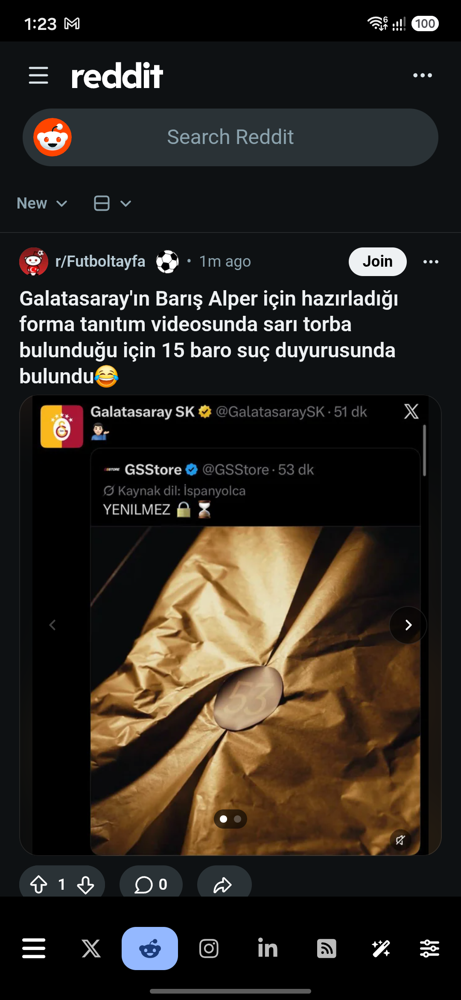
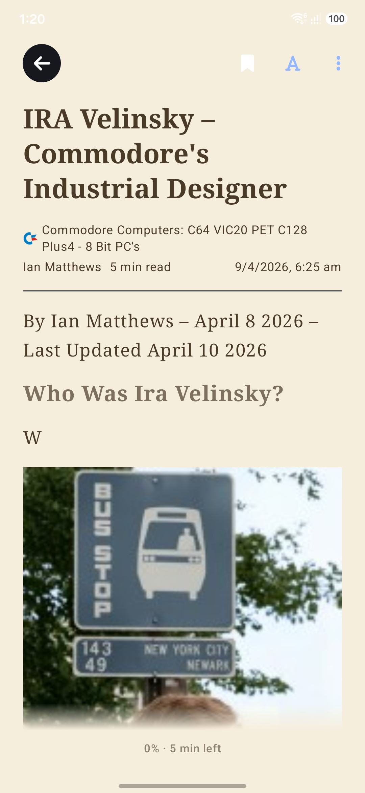
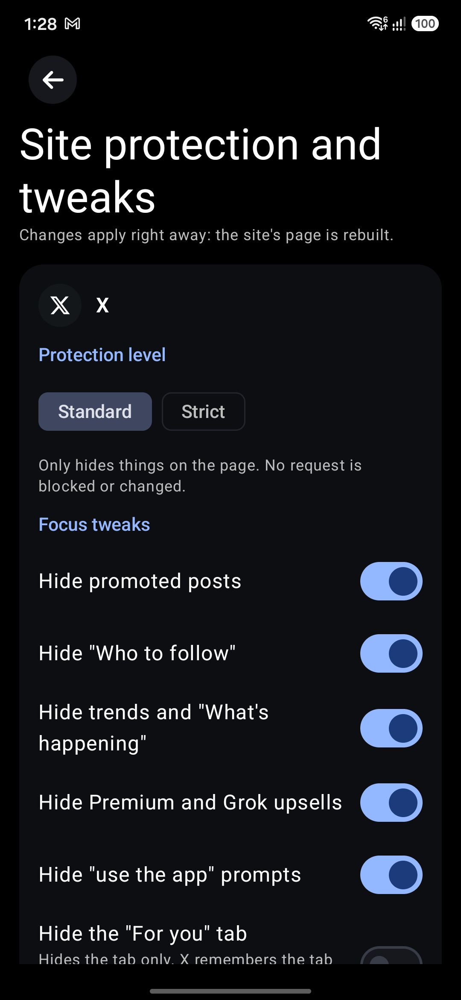
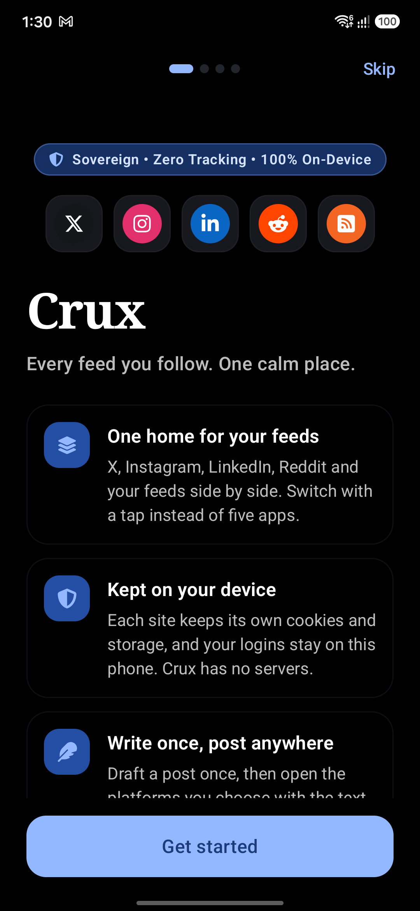

<p align="center">
  
</p>

<h1 align="center">Crux</h1>

<p align="center">
  <strong>Every feed you follow. One calm place.</strong><br>
  Separate web tabs for social networks (Instagram, X, LinkedIn, Reddit, mastodon.social) and a native RSS reader.
</p>

<p align="center">
  <a href="LICENSE"></a>
  
  <a href="https://github.com/tejalogs/crux/releases/latest"></a>
  <a href="https://github.com/tejalogs/crux/releases/latest"></a>
  
</p>

---

## 📱 Screenshots

| Private Web Tabs | RSS Timeline | Distraction-Free Reader |
|:---:|:---:|:---:|
|  |  |  |
| **Privacy & Tweaks** | **On-Device AI** | **Customizable Interface** |
|  |  |  |

---

## ✨ Features

- **🛡️ Separate Web Profiles**
  Instagram, X, LinkedIn, Reddit and mastodon.social each get their own WebView profile when the device's WebView supports profiles, so one site's cookies, sessions, local storage and cache are not visible to another. On a WebView without profile support the sites fall back to one shared cookie jar inside Crux. Either way, every site sees the same IP address and device fingerprint, so sites and ad networks can still link your visits. You log in directly on each service's official website.
- **🧘 Privacy & Focus Tweaks**
  Page tweaks built into each tab. Most only hide things on screen; on Reddit they also remove the `inert`, `aria-hidden` and NSFW-blur attributes that lock the page. The injected scripts run in the page, so the site's own JavaScript can see them:
  - Hide distracting feeds (Instagram Reels/Explore, X "Who to follow" & Trends, Reddit app-install banners, LinkedIn sponsored ads).
  - Tap-to-play video, available in every tab and on by default for Reddit and LinkedIn.
  - Per-site data purge button to wipe cookies and storage for any individual platform instantly.
  - Optional Global Privacy Control (GPC) signal, off by default and only on sites set to Strict. It is the `navigator.globalPrivacyControl` JavaScript property, not a `Sec-GPC` request header.
  - Automatic tracking parameter stripping (`utm_*`, `fbclid`, etc.) on links that leave a tab.
  - Privacy Checkup: one tap opens the privacy settings each site offers (for example ad personalisation, off-site activity, AI training on X and LinkedIn, and download your data) in that site's tab. You change them on the site; Crux never acts inside your account.
  - Optional Screenshot Protection (prevents capture and Android task switcher previews).
- **📰 Native RSS & Paged Article Reader**
  Full RSS/Atom reader built right alongside your social feeds:
  - Add feeds individually or bulk import/export OPML collections.
  - Chronological reading timeline with bookmarking support.
  - Distraction-free, paged reader that remembers your exact reading spot across articles.
- **🔒 On-Device AI**
  Draft replies, rephrase thoughts, and summarize long posts with no API keys or cloud AI. Prompts run on your device and are not sent to an AI server. Downloading a model fetches it from Hugging Face, which sees your IP address and which model you chose. An old cloud AI setting from an earlier version is switched to on-device when Crux reads its settings, and its server address and key are never used.
- **🚫 No Crux Telemetry & No Crux Server**
  Crux has no accounts, telemetry, analytics, ad networks, or crash reporters of its own. Nothing is sent to the Crux developer. Crux does ask the GitHub releases API whether a new version exists (on by default; turn it off in Settings > About). Android Auto-Backup and device-to-device transfers are disabled, so web cookies and login tokens are not copied off the device by Android backup. The sites you open still run their own analytics inside their pages.

---

## 📥 Installation

Crux supports **Android 8.0 (API 26)** and newer.

### Official Downloads
Directly download the signed APK:
👉 **[Download Crux v1.0.13 APK](https://github.com/tejalogs/crux/releases/tag/v1.0.13)** (65.3 MB)

Verify a download: every release ships a `SHA256SUMS` file and a GitHub build-provenance attestation, and the APK is signed with this certificate:
`SHA-256 57:2E:CC:66:D3:0C:C3:56:F7:AF:0A:BE:5B:9B:D9:18:3E:F4:17:B4:1E:D1:9B:18:AF:7D:E6:9F:4D:98:1C:7C`

```bash
apksigner verify --print-certs app-release.apk
gh attestation verify app-release.apk -R tejalogs/crux
```

You can also visit the web showcase at **[tejalogs.github.io/crux](https://tejalogs.github.io/crux/)**.

---

## 🔒 Privacy & Architecture

For full details, read [docs/PRIVACY.md](docs/PRIVACY.md). Key architecture guarantees:

1. **No Password Storage**: Crux never requests or intercepts your credentials. You log in on the real web page of each service.
2. **Profile Isolation**: Uses Android WebView multi-profile APIs, where the device's WebView supports them, to keep each site's cookies and cache separate. Without that support the sites share one cookie jar inside Crux. Shared IP address and device fingerprint can still link visits across sites.
3. **No Central Server**: Crux operates purely client-side; there is no backend server collecting user profiles or analytics. The app does contact GitHub to check for updates and Hugging Face to download AI models, as described in [docs/PRIVACY.md](docs/PRIVACY.md).
4. **Local AI**: Smart replies and summaries run on the device. Crux has no translation feature and no cloud AI.
5. **Limits**: inside a signed-in site, Crux cannot stop the site's own tracking of what you view, tap and search, or the ads it serves and counts. See "What Crux cannot protect" in [docs/PRIVACY.md](docs/PRIVACY.md).

---

## 🛠️ Building from Source

### Prerequisites
- JDK 17+
- Android SDK (API 34+)

### Commands

```bash
# Assemble debug APK
./gradlew :app:assembleDebug

# Assemble release APK
./gradlew :app:assembleRelease

# Run all unit tests
./gradlew :app:testDebugUnitTest :shared:jvmTest :feature:subscription:jvmTest :feature:agent:jvmTest
```

Binary outputs:
- Release APK: `app/build/outputs/apk/release/app-release.apk`
- Debug APK: `app/build/outputs/apk/debug/app-debug.apk`

---

## 🤝 Contributing

Contributions are welcome! Please review [CONTRIBUTING.md](CONTRIBUTING.md) for code style, branch guidelines, and testing requirements before opening a PR.

---

## 📜 License & Acknowledgments

Crux is free and open-source software licensed under the **[GNU Affero General Public License v3.0](LICENSE)**.

Crux is built upon [Flare](https://github.com/DimensionDev/Flare) by DimensionDev, also licensed under AGPL-3.0. We are deeply grateful to DimensionDev and the open-source community for their foundational work.
